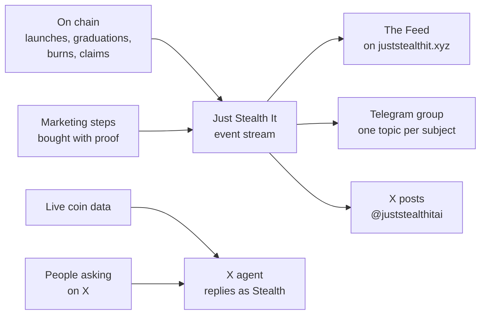

# Stealth Bots

The bots of [Just Stealth It](https://juststealthit.xyz) ($STEALTH), a multi-chain launchpad and trading terminal.

This guide covers what each bot does, where it posts, how to use it, and what's coming. It's for traders, coin creators and anyone in the community.

| | |
| --- | --- |
| Site | [juststealthit.xyz](https://juststealthit.xyz) |
| Telegram community | [t.me/juststealthit](https://t.me/juststealthit) |
| Telegram bot | [@juststealthbot](https://t.me/juststealthbot) |
| X | [x.com/juststealthit](https://x.com/juststealthit) |
| X agent | [@juststealthitai](https://x.com/juststealthitai) |
| Platform docs | [github.com/juststealthit/docs](https://github.com/juststealthit/docs) |
| Support | The form on [juststealthit.xyz/status](https://juststealthit.xyz/status) |

## The bots at a glance

| Bot | Where it lives | What it does | State |
| --- | --- | --- | --- |
| **Community poster** | The topics of [t.me/juststealthit](https://t.me/juststealthit) | Posts launches, graduations, marketing, $STEALTH buy-backs and fee claims as they happen | On |
| **Updates poster** | The UPDATES topic | Team announcements, milestones and short posts about the product | On |
| **Private bot** | A private chat with [@juststealthbot](https://t.me/juststealthbot) | A Solana launch terminal and wallet, driven by buttons | Built, **currently off** |
| **X posts** | [@juststealthitai](https://x.com/juststealthitai) | Platform updates, event cards, $STEALTH buy-back roundups and memes | On |
| **X agent** | Replies from [@juststealthitai](https://x.com/juststealthitai) | Answers real questions about coins and the platform, as "Stealth" | On |

## How they fit together

Everything starts on chain. The platform watches what happens, writes each moment down once, and each bot picks what it cares about.

## Contents

| Page | What it covers |
| --- | --- |
| [How the bots work](docs/how-it-works.md) | The event stream, what counts as an event, and where each one goes |
| [The Telegram group](docs/telegram-group.md) | Every topic, what lands in it, what a post looks like, and how busy topics stay readable |
| [Updates](docs/updates.md) | The UPDATES topic: announcements, milestones and product posts |
| [The private bot](docs/telegram-bot.md) | @juststealthbot's wallet and launch flow, step by step |
| [X posts](docs/x-posts.md) | What @juststealthitai posts on its own, and the rules every post follows |
| [The X agent](docs/x-agent.md) | Who Stealth answers, what it can tell you about a coin, and when it stays quiet |
| [Staying safe](docs/safety.md) | Real accounts, fake accounts, and what the bots will never do |
| [Coming soon](docs/roadmap.md) | Planned features. No dates |
| [FAQ](docs/faq.md) | Short answers |

## Start here

**Traders.** Join [t.me/juststealthit](https://t.me/juststealthit) and open the topic for your chain. New coins land there and in All Launches. See [The Telegram group](docs/telegram-group.md).

**Coin creators.** Your launch is posted to All Launches and your chain's topic on its own. Graduations and marketing steps get their own posts too. You don't need to do anything. See [How the bots work](docs/how-it-works.md).

**$STEALTH holders.** Every buy-back and burn of $STEALTH is posted in BUYBACKS, buy first, burn after, each with its transaction. See [The Telegram group](docs/telegram-group.md#buybacks).

**Curious about a coin?** Ask [@juststealthitai](https://x.com/juststealthitai) on X with the coin's $TICKER or address. See [The X agent](docs/x-agent.md).

## Fine print

The bots post facts read from the chain and from the platform. Some text and images are generated by the Stealth agent and can be wrong. Check the transaction and the coin's page.

Coins launched on Just Stealth It are created by anyone, and you can lose everything you put in. Nothing a bot posts or replies is financial advice or a promise of any return.

The bots aren't a support channel. Use the form on [juststealthit.xyz/status](https://juststealthit.xyz/status). **Nobody from Just Stealth It will ever ask for your recovery phrase or private key.**

## License

[MIT](LICENSE)
