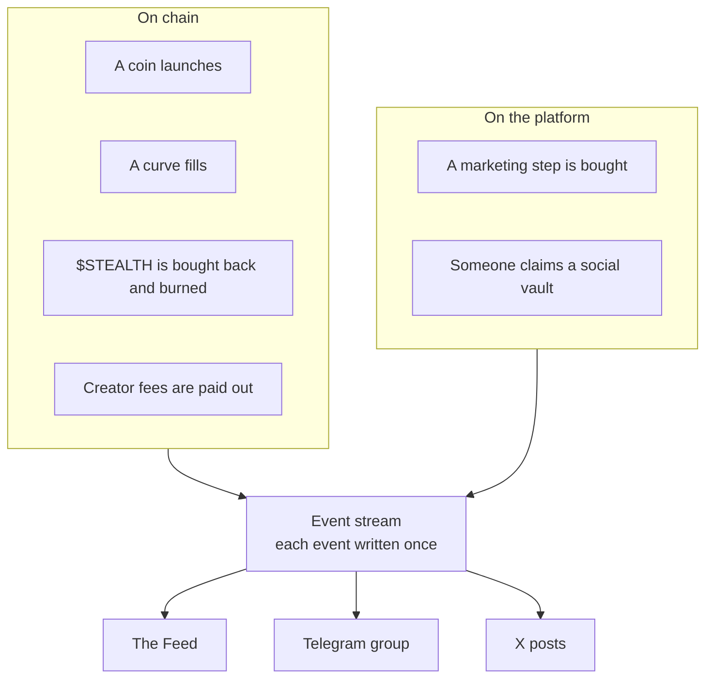
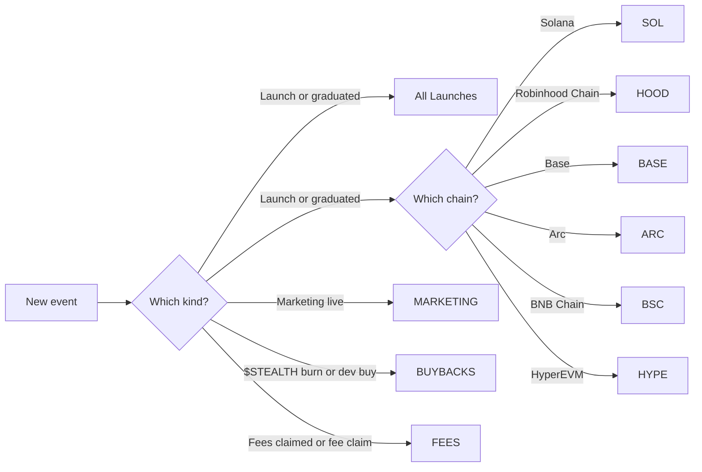

# How the bots work

## One stream of events

Just Stealth It keeps one record of what happens on the platform, called the **event stream**. Every few seconds it reads what's new and writes each moment down once.

The Feed on juststealthit.xyz, the Telegram group and the X account all read from that same stream. That's why a launch shows the same name, numbers and link everywhere.

## What counts as an event

| Event | What happened | Chains |
| --- | --- | --- |
| **Launch** | A coin launched on Just Stealth It | Every chain |
| **Graduated** | A coin's bonding curve filled and it moved into its own pool | Every chain |
| **Marketing live** | A coin's marketing pot bought its next step, such as a DexScreener boost or a listing. A proof link comes with it | Every chain |
| **Burn** | $STEALTH was bought back and burned by the official wallets | Solana |
| **Dev buy** | The official $STEALTH wallet bought $STEALTH | Solana |
| **Fees claimed** | Someone claimed the fees waiting in their [social vault](https://github.com/juststealthit/docs/blob/main/docs/social-vaults.md) | Every chain |
| **Fee claim** | A coin's creator fees were claimed or paid out | Every chain |

There is no general buy or sell feed. The only buys the bots post are the official $STEALTH buy-backs.

A coin on a **Buy back and burn** launch type burns its own supply too. Those burns show on the coin's page and the Feed. They don't go to the BUYBACKS topic, which is only for $STEALTH.

Social vaults are built and currently off, so **Fees claimed** posts start once they're switched on.

## What never gets in

- Anything that failed or isn't confirmed on chain.
- Coins hidden by moderation.
- Coins launched somewhere else.

## The same event is posted once

Each event has a fixed identity, built from the chain and the transaction. If two parts of the platform report the same burn, it's still one event. If a bot restarts, it doesn't post anything twice.

A post that may have gone out is never sent again, even if Telegram or X didn't answer. Missing a post is better than a duplicate.

## Where each event goes

| Event | Telegram topic | X |
| --- | --- | --- |
| Launch | All Launches **and** the chain's topic | Not posted. Launches stay on Telegram and the Feed |
| Graduated | All Launches **and** the chain's topic | A card |
| Marketing live | MARKETING | A card |
| Burn ($STEALTH) | BUYBACKS | Added up in the [roundup](x-posts.md#buy-back-roundups) |
| Dev buy ($STEALTH) | BUYBACKS | Added up in the [roundup](x-posts.md#buy-back-roundups) |
| Fees claimed | FEES | A card |
| Fee claim | FEES, unless it's very small | Not posted |

## Late events

The bots post things as they happen. If an event reaches a bot late, for example after a restart, it isn't posted hours after the fact. It's still on the Feed.

## Where the words and pictures come from

| Part | Where it comes from |
| --- | --- |
| Names, tickers, chains, amounts, links | Read from the chain and the platform |
| Telegram text | Fixed wording, filled in with those facts |
| Cards | A template with the coin's logo and, where there is one, the person's avatar |
| Big moments | Graduations and marketing steps can get a drawn card from the Stealth agent |
| X text | Written by the Stealth agent, then checked against the facts. See [the rules](x-posts.md#the-rules-every-post-follows) |

A coin's name is whatever its launcher typed. The bots strip anything from it that could act as a link, a mention or formatting.

Next: [The Telegram group](telegram-group.md)
