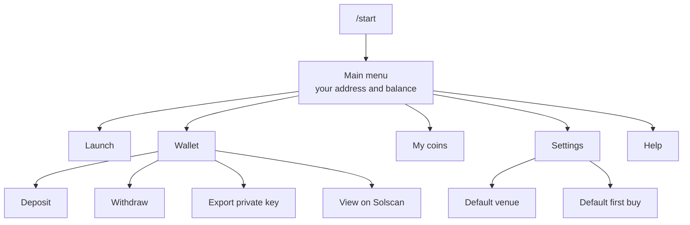
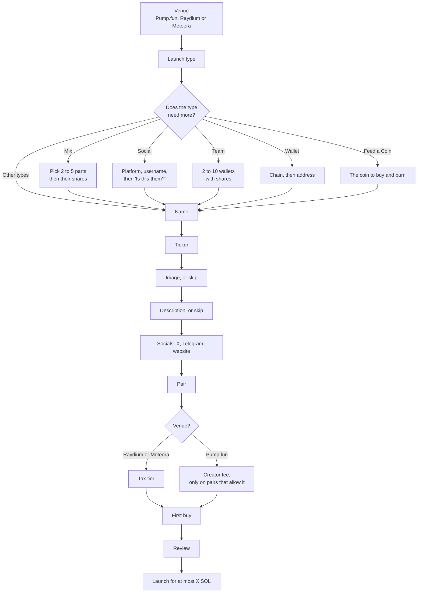
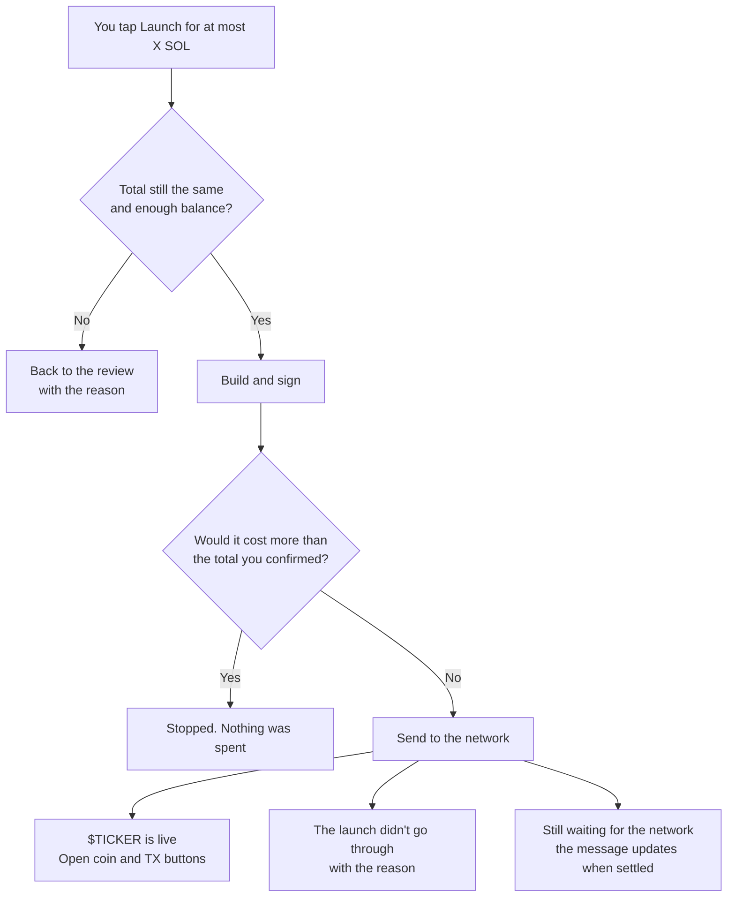

# The private bot

> **Built and currently off.** This page describes how [@juststealthbot](https://t.me/juststealthbot)'s private chat works once it's switched on. Until then, launch from [juststealthit.xyz](https://juststealthit.xyz).

The private chat is a launch terminal and a wallet. You launch a coin on Solana with buttons, from Telegram, using the same launch service as the site. Before you confirm, it shows the most the launch can cost.

## Before you start: who holds the key

**Just Stealth It holds this wallet's key** and signs for you when you confirm a launch or a withdrawal. That's what lets a button do the work.

- Keep in it only what you plan to use.
- You can export the key at any time. Whoever has the key controls the wallet.
- This is different from the site, where you connect your own wallet and sign your own transactions.

## Getting in

Open [@juststealthbot](https://t.me/juststealthbot) and send `/start`. The first time, the bot makes a Solana wallet for your Telegram account. It's yours alone: everything in the chat answers to your Telegram user, and nothing anyone sends can point at another wallet.

| Command | Opens |
| --- | --- |
| `/start` | The main menu |
| `/launch` | A new launch, or the one you left |
| `/wallet` | Your wallet |
| `/help` | Help, with your limits |
| `/cancel` | Back to the main menu |

The bot only answers in a private chat. In a group it says nothing.

## The main menu



| Screen | What it does |
| --- | --- |
| **Launch** | The launch flow below |
| **Wallet** | Address, balance, deposit, withdraw, export, and a Solscan link |
| **My coins** | The coins this wallet launched: venue, launch type, and whether it graduated. Each opens its page |
| **Settings** | A default venue and a default first buy, so new launches start with them. **Clear** resets both |
| **Help** | How it works, who holds the key, and your limits |

## The wallet

### Deposit

**Deposit** shows your address. Send SOL on Solana to it. It shows up once the network confirms it.

### Withdraw

1. Tap **Withdraw** and send the Solana wallet to withdraw to.
2. Pick **25%**, **50%** or **Max**, or type an amount in SOL.
3. Check the confirm screen: the amount, the network fee and the address.
4. Tap **Send**. The message updates until the network settles it, then shows the transaction.

Withdrawals send SOL. Tokens from a first buy stay in the wallet. To move tokens, export the key into a wallet app.

The bot refuses an address that isn't a wallet, because nothing could ever spend from it. It also refuses this wallet's own address.

### Export private key

1. Tap **Export private key**. A warning explains what the key is.
2. Tap **I understand, show my key**.
3. The key arrives in a message you can tap to copy. Telegram won't let it be forwarded.
4. About 60 seconds later the bot deletes that message.

Have somewhere safe ready before you tap. Every export is logged, without the key.

## Launching a coin

The launch is one screen per step. Each screen says which step you're on, and has **Back** and **Cancel**. Steps that don't apply to your choices don't appear.



### The steps

| Step | What you do | Notes |
| --- | --- | --- |
| **Venue** | Tap Pump.fun, Raydium or Meteora | EVM chains show **soon**. Launch them from the site for now |
| **Launch type** | Tap where creator fees go | Only types that are on show up. Locked at launch |
| **Name** | Send the coin's name | Up to 32 characters |
| **Ticker** | Send the ticker | Up to 10 characters, no spaces. A leading `$` is fine |
| **Image** | Send a picture, or an https link to one | PNG, JPEG, WebP or GIF, up to 2 MB. You can skip it |
| **Description** | Send what the coin is about | Up to 1000 characters. You can skip it |
| **Socials** | Send https links, one message each | X, Telegram or a website |
| **Pair** | Tap SOL or another listed pair, or send a name, ticker or address to search | You pick from the results, because tickers aren't unique |
| **Tax** | Tap a tier | Raydium and Meteora only. Locked at launch |
| **Creator fee** | Send a percentage, or keep Pump's schedule | Only on Pump.fun pairs that let a coin set its own |
| **First buy** | Tap none, 0.1, 0.5 or 1 SOL, or send an amount | Your own buy in the launch, before anyone else. The screen shows the most you can buy |
| **Review** | Check everything, then confirm | See below |

Global tax on Meteora is built and currently off. When it's on, Meteora launches on a SOL pair get an extra step for it.

### Launch types

The launch type screen lists each available type with one line on where creator fees go. The full rules are in the platform docs under [Launch types](https://github.com/juststealthit/docs/blob/main/docs/launch-types.md).

| Type | Extra steps in the bot |
| --- | --- |
| Creator | None. Fees go to this bot wallet |
| Team | Send 2 to 10 Solana wallets, one per line, each with a share. Shares add up to 100 |
| Wallet | Pick a chain, then send the address. Don't use an exchange deposit address that needs a memo or tag |
| Social | Pick the platform, send the username, then check the "Is this them?" card. Naming someone doesn't mean they endorse the coin |
| Feed a Coin | Send the mint of the coin to buy and burn |
| Mix | Pick 2 to 5 parts, then send their shares in order, or tap **Split evenly** |
| Holders, Diamond Hands, Buy back and burn, Auto Liquidity, Marketing | None |

Social vaults are built and currently off, so **Social** only shows once they're on.

Example Team message:

```text
ADDRESS_ONE 60
ADDRESS_TWO 40
```

### The review

The review shows everything you picked, and the money:

| Line | What it means |
| --- | --- |
| First buy | What you chose to buy |
| Coin accounts and network | The most the launch's own costs can be |
| **Total: at most** | The most this launch can take from the wallet |
| Wallet | Your balance now |

If the wallet is short, the review says how much to deposit and where, and shows **Refresh** instead of the launch button.

The venue, pair, tax and launch type are locked at launch.

### After you confirm

The confirm message turns into a progress message.

```text
Launching Example Coin

✓ Checking your launch
✓ Building the transactions
✓ Signing
… Sending
· Waiting for the network
· First buy
```



What protects you here:

- **The total is checked again** when you tap. If the cost went up or the balance went down, you go back to the review.
- **The launch can't cost more than you confirmed.** If it would, it's stopped and nothing is spent.
- **The launch and your first buy land together** where the venue allows, so nobody can buy in between.
- **One at a time.** While a launch or withdrawal is running, the bot won't start another.
- **A failure tells you what happened**: nothing spent, or part of it landed and you should check your balance.

When it's live you get the coin's address, what it cost, and buttons to **Open coin** and see the **TX**.

### Leaving and coming back

Your launch is saved as you go. Send `/launch` later and the bot asks whether to **Continue** or **Start over**.

## Buttons expire

Each button works once, and only for you.

- Menu buttons expire after a while. Tap an old one and the bot asks you to send `/start`.
- Screens that move money or show a key expire after a couple of minutes.
- Tapping **Confirm** twice doesn't send twice.

## Limits

There are per-user limits on launches, withdrawals and key exports, and a daily ceiling for all users together. **Help** shows your limits. If you hit one, the bot says which and when to try again.

If the bot ever reaches its overall daily ceiling, you can still reach your funds with your exported key.

## What the private bot can't do yet

| Feature | State |
| --- | --- |
| Launch on Robinhood Chain, BNB Chain, HyperEVM, Base or Arc | Coming soon. Use the site |
| Multi-chain launches | Coming soon. Use the site |
| Buy and sell coins | [Planned](roadmap.md) |
| Withdraw tokens | Export the key into a wallet app for now |
| Alerts | [Planned](roadmap.md) |

Next: [X posts](x-posts.md)
