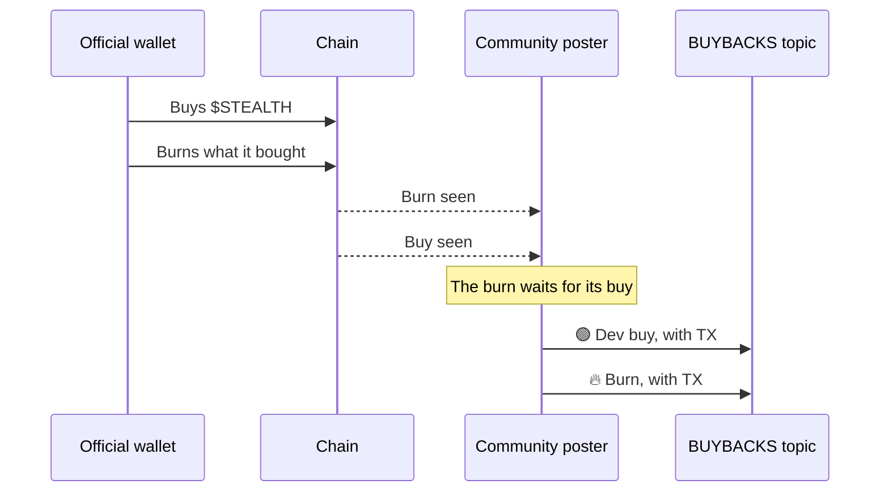
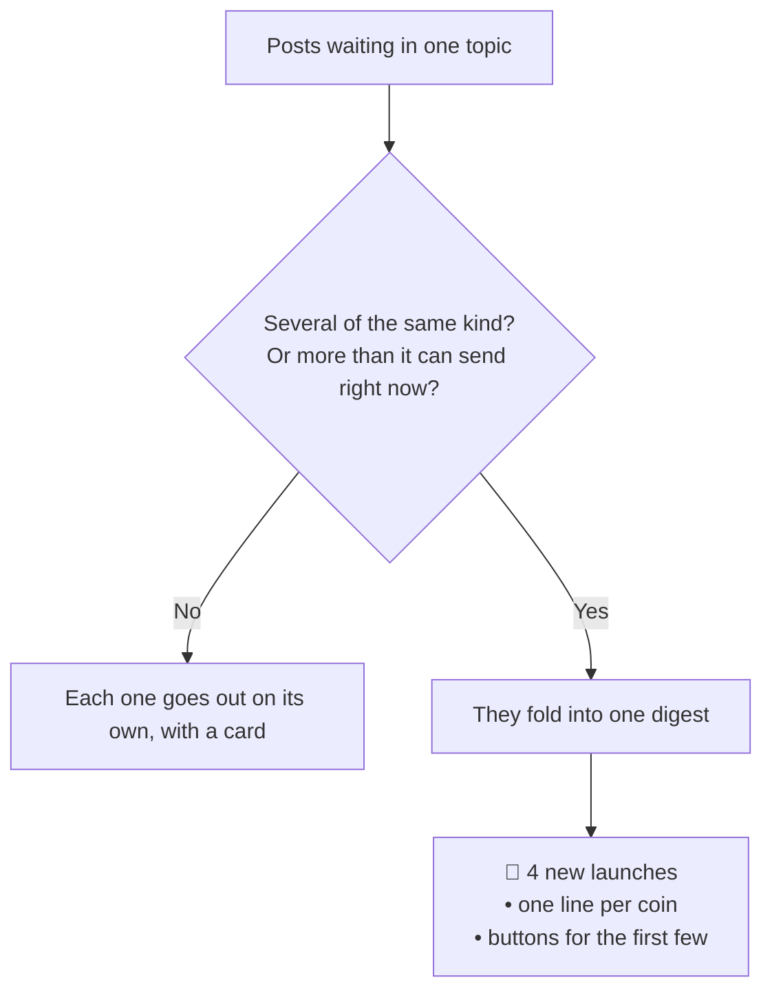

# The Telegram group

[t.me/juststealthit](https://t.me/juststealthit) is a forum group. Each subject has its own topic, so you can follow only what you care about. The community poster fills the topics in real time from the [event stream](how-it-works.md).

## Topics

| Topic | What lands there |
| --- | --- |
| **All Launches** | Every launch and every graduation, on every chain |
| **SOL** | Launches and graduations on Solana |
| **HOOD** | Launches and graduations on Robinhood Chain |
| **BASE** | Launches and graduations on Base |
| **ARC** | Launches and graduations on Arc |
| **BSC** | Launches and graduations on BNB Chain |
| **HYPE** | Launches and graduations on HyperEVM |
| **MARKETING** | A coin's marketing pot bought its next step |
| **BUYBACKS** | Buy-back and burn of $STEALTH |
| **FEES** | Creator fee claims and social vault claims |
| **UPDATES** | Announcements and product posts. See [Updates](updates.md) |

A launch is posted twice: once in All Launches and once in its chain's topic. Mute All Launches if you only follow one chain.

## What a post looks like

Each post starts with a line that says what happened, then the coin, then the details, then a link to the coin's page.

| Lead | Topic | Details line |
| --- | --- | --- |
| 🚀 New launch | All Launches, chain topic | The chain |
| 🎓 Graduated | All Launches, chain topic | The chain |
| 📈 Marketing live | MARKETING | The step it bought |
| 🔥 Burn | BUYBACKS | Tokens burned, SOL spent, value |
| 🟢 Dev buy | BUYBACKS | Tokens bought, SOL spent, value |
| 💼 Fees claimed | FEES | Whose social account, and how much |
| 💰 Fee claim | FEES | How much, and to whom where it's a social account |

An example launch post, with made-up values:

```text
🚀 New launch: Example Coin (EXAMPLE)
Solana

https://juststealthit.xyz/token/<coin address>
```

```text
[ TX ]  [ example_handle on X ]
[ Open on Just Stealth It ]
```

### Buttons

| Button | Shown when | Opens |
| --- | --- | --- |
| **TX** | The event has a transaction | The transaction on the chain's explorer |
| **handle on X** (or TikTok, Twitch, GitHub) | Fees go to a social account | That person's public profile |
| **Proof** | A marketing step was bought | The proof of the purchase |
| **Open on Just Stealth It** | Always | The coin's page, or the burn page |

Every link goes to the chain's explorer, the person's public profile, or juststealthit.xyz. Text is sent plain, so a coin's name can't hide a link.

### Cards

A single post comes with a card: the coin's logo, the numbers, and the person's avatar where there is one. Graduations and marketing steps are the big moments. They can get a drawn card from the Stealth agent instead. If no card can be made, the text goes out alone.

## BUYBACKS

BUYBACKS is only for $STEALTH. It posts each buy of $STEALTH by the official wallets and each burn that follows.

A buy-back always reads in order: the buy first, then its burn. If the burn reaches the bot first, it waits a short while for its buy. A burn with no buy, such as a burn done by hand, goes out once the wait is over.



Each post has the transaction, so you can check the amount and that the tokens were destroyed. A burn reduces the supply. It isn't a promise of any price or value.

Coins on the **Buy back and burn** launch type burn their own supply too. Those burns show on the coin's page and the Feed, not here.

## FEES

FEES shows money leaving a coin's escrow to the people it belongs to.

- **Fee claim**: a coin's creator fees were claimed or paid to its wallets. Very small claims are skipped so the topic stays readable.
- **Fees claimed**: someone signed in with their social account and claimed the fees waiting for them. Social vaults are built and currently off, so these start once they're on.

Where the fees go is set by the coin's [launch type](https://github.com/juststealthit/docs/blob/main/docs/launch-types.md).

## MARKETING

A coin on the **Marketing** launch type, or a Mix with a marketing slice, fills a marketing pot from its own trading fees. Each time the pot buys a step on the [marketing ladder](https://github.com/juststealthit/docs/blob/main/docs/marketing.md), a post goes here with a **Proof** button.

## When a topic gets busy

On a busy day the poster folds posts together instead of flooding the topic.



A digest has one line per coin and buttons for the first few. Digests are text only.

The poster also keeps to Telegram's own pace. If Telegram asks it to wait, it waits and loses nothing.

## The bot only posts here

The community poster posts in [t.me/juststealthit](https://t.me/juststealthit) and nowhere else. If someone adds it to another group, it leaves. A bot with a similar name posting in another group isn't ours. See [Staying safe](safety.md).

Next: [Updates](updates.md)
