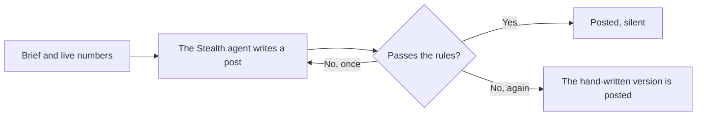

# Updates

The UPDATES topic is where the team talks to the community. The updates poster puts three kinds of posts there.

| Kind | What it is | Pinned | Notification |
| --- | --- | --- | --- |
| **Announcements** | Written by the team | When it matters | Yes |
| **Milestones** | A coin's marketing step was bought, or a coin graduated | Marketing steps are pinned | Yes |
| **Product posts** | Short posts about how the platform works and what's live | No | Silent |

## Milestones

A milestone posts once, when it happens.

```text
EXAMPLE just got a DexScreener boost 📈

paid for by its own trading fees

https://juststealthit.xyz/token/<coin address>
```

```text
EXAMPLE just graduated 🎓

it filled its curve and trades in its own pool now

https://juststealthit.xyz/token/<coin address>
```

Milestones go before product posts. Only one goes out at a time, so a busy hour doesn't bury the topic.

## Product posts

Between milestones, a product post goes out every so often. Each one is about one thing, and the subject changes from one post to the next.

| Subject | What it talks about |
| --- | --- |
| **How it's built** | Venues, escrows, holder rewards, the anti-sniper fee, the indexer |
| **Where it's going** | Plans, without dates |
| **What you can do today** | Launch types, pairs, the marketing ladder, CTO, wallet pages, languages |
| **Progress** | Live numbers: coins launched, graduations, 24h volume, $STEALTH burned, marketing steps bought |
| **Why** | What Just Stealth It believes about trading fees |

A post that depends on a fact only goes out while the fact is true. For example, a post about the $STEALTH buy-back only goes out while the buy-back is running.

The Stealth agent writes these posts fresh each time, from a short brief and the live numbers. If it can't, a hand-written version goes out instead.

### The rules

Every product post is checked before it's sent. A post that breaks a rule is rewritten or replaced.

- Every number must come from the live data.
- No dates or timelines. A plan is a plan.
- No promises, no price talk, no "buy now", no airdrops or giveaways.
- No links except juststealthit.xyz.
- Short, plain text.



## Announcements

Announcements are written by the team, not a bot. The bot only delivers them. Important ones are pinned.

An announcement never asks you to connect a wallet on another site, send funds, or share a key. If you see one that does, it isn't from us. See [Staying safe](safety.md).

Next: [The private bot](telegram-bot.md)
