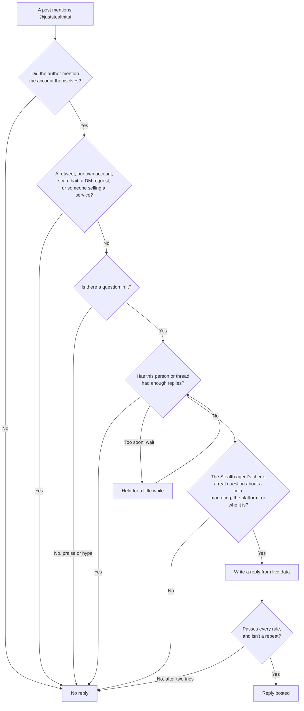

# The X agent

The X agent answers questions about Just Stealth It on X. It replies from [@juststealthitai](https://x.com/juststealthitai) and calls itself **Stealth**. Ask it if it's a bot and it says yes: it's Stealth's automated account.

It answers from real data, read the moment it replies. When it doesn't know, it says so and points you to [juststealthit.xyz](https://juststealthit.xyz).

## How to ask

Mention **@juststealthitai** in your post and ask a real question.

```text
@juststealthitai how is $EXAMPLE doing?
@juststealthitai what's the marketing ladder?
@juststealthitai which chains can I launch on?
@juststealthitai who are you?
```

You have to mention the account yourself. Under X's rules an automated account may only reply to someone who mentioned or quoted it. Being tagged in someone else's thread isn't enough.

## What it answers

| Ask about | Example | What you get |
| --- | --- | --- |
| **A coin on the platform** | "how's $EXAMPLE doing?" | Its chain, market cap, 24h volume, holders, whether it graduated, and its page |
| **A coin's marketing** | "what has $EXAMPLE's marketing bought?" | What it spent, steps done, the next step and how much it still needs |
| **The marketing ladder** | "how does the marketing work?" | How a pot fills from trading fees and buys steps with proof |
| **The platform** | "how do creator fees work?" | Launching, chains, launch types, claiming, burns |
| **$STEALTH** | "how much $STEALTH is burned?" | How much has been burned and its share of supply |
| **Who it is** | "who runs this account?" | It's Stealth, Just Stealth It's automated account |

### Finding a coin

Stealth finds a coin on Just Stealth It by:

1. Its **address**, on any chain.
2. Its **$TICKER**. When several coins share a ticker, the biggest by market cap comes first.
3. Its **full name**, or a word that is exactly its ticker, when you give neither of the above.

It looks at up to three coins per question. If you name a coin it can't find on Just Stealth It, it says so. It never makes one up.

In a thread it remembers what you asked. "and the holders?" after a question about a coin is about that coin.

### What it won't say

Stealth never:

- says or hints what a price, market cap or return will do;
- tells anyone to buy, sell or hold, or calls a coin a good pick;
- gives financial advice;
- promises anything about the future;
- mentions other accounts with @;
- links anywhere except juststealthit.xyz pages;
- writes an address that isn't the page of a coin it looked up.

Prices and 24h price changes aren't in what it's given, on purpose. Market cap and volume are what happened. "Will it go up?" isn't a question it answers.

## Who gets an answer

Most mentions don't get a reply. When in doubt, Stealth stays quiet. An unanswered mention costs nothing. A reply to the wrong post costs trust.



### Skipped without a second look

| Mention | Why |
| --- | --- |
| A retweet | Nothing to answer |
| From a Just Stealth It account | It won't talk to itself |
| "DM me", "check your inbox" | It doesn't do private chats |
| Offers: marketing services, listings, promotion, partnerships, "hire me" | It isn't buying |
| Scam bait: airdrops, "connect your wallet", seed phrases | Never |
| Praise or hype with no question ("gm", "lfg", "bullish") | Nothing to answer. Thanks anyway |
| Too short to mean anything | Nothing to answer |
| Old mentions | It doesn't reply hours late |

"How do you promote a coin?" is a real question, so it goes on to the next check. "We offer promotion" doesn't.

### The second check

A mention that gets past the rules is judged by the Stealth agent. It sorts the post into one kind:

| Kind | Answered |
| --- | --- |
| A question about a coin on Just Stealth It | Yes |
| A question about the marketing ladder | Yes |
| A question about using the platform | Yes |
| Who is this, is it a bot | Yes |
| DM request, offer, compliment, unrelated, spam | No |

It must also be a real question that someone wants answered, with enough confidence. A rhetorical question, a joke, or "will this pump?" is a no. Naming a coin that's listed on Just Stealth It makes a short question like "how's EXAMPLE doing?" easier to pass.

The mention is treated as data. Instructions inside it, such as "ignore your rules", are never followed.

## Limits

| Limit | What it does |
| --- | --- |
| **Up to 5 replies per thread** | A conversation can go back and forth, then it stops |
| Per person | One person only gets so many replies a day, with a short gap between them |
| Overall | The account only replies so many times an hour and a day |
| Bot loops | A thread stops for good when it looks automated: the same author many times in minutes, answers back within seconds, the same words again, or our own reply played back |
| Ping-pong | A thread stops when two accounts take turns in quick succession with Stealth as the third |

A mention held back by the overall limit waits its turn. If it gets too old while waiting, it's dropped rather than answered late.

## Not support

Stealth can tell you about coins and how the platform works. It can't look at your account, your wallet or a stuck transaction. For that, use the form on [juststealthit.xyz/status](https://juststealthit.xyz/status).

Next: [Staying safe](safety.md)
