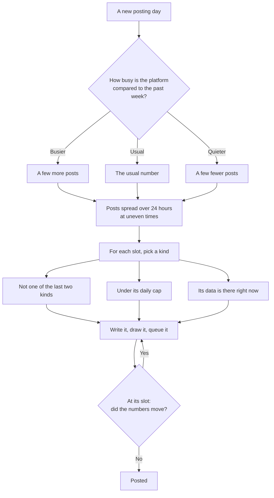

# X posts

[@juststealthitai](https://x.com/juststealthitai) is the Stealth agent's account. It posts on its own through the day. The main Just Stealth It account is [x.com/juststealthit](https://x.com/juststealthit).

There are four kinds of automated post.

| Kind | What it is | When |
| --- | --- | --- |
| **Updates** | Numbers and news from the platform | On a schedule through the day |
| **Memes** | A picture and a short caption about the market's mood | On a schedule, about half the day's posts |
| **Event cards** | A graduation, a marketing step, a social fee claim | When it happens |
| **Buy-back roundups** | $STEALTH buy-backs and burns, added up | Once per time window |

New launches aren't posted on X. They go to [Telegram](telegram-group.md) and the Feed.

## Updates

| Update | Shows | Picture |
| --- | --- | --- |
| **Top coins** | The coins launched here with the most 24h volume | Card |
| **The last 24 hours** | Launches, graduations and volume | Card |
| **Graduation** | A coin that filled its curve | Card |
| **Coin in focus** | One coin, with its numbers and page | Text |
| **Trending on Solana** | What's trending on Solana right now | Text |
| **$STEALTH burned** | How much $STEALTH has been burned | Text |
| **Marketing unlocked** | A coin's pot reached its next marketing step | Text |
| **Marketing done** | A coin's marketing step was bought | Text |
| **Banter** | A light nudge about what's happening on the platform | Text |

Each kind has a daily cap, and the same kind doesn't come up twice in a row. A marketing step that just unlocked goes ahead of the others.

## How the day is planned

The account keeps its next few posts ready ahead of time. Each one is written and drawn before its slot.

Just before a post goes out, its numbers are read again. If a ranking changed or a figure moved noticeably, the post is written again with fresh numbers. A post that missed its slot by a long way is dropped, not posted late.

## Memes

About half the posts are memes. The Stealth agent reads the market's mood, from a public fear and greed index and the day's move in BTC and SOL, and makes a meme to match.

| Mood | The kind of joke |
| --- | --- |
| Capitulation | Gallows humour, "it's so over", not looking at the chart |
| Bearish | Coping, touching grass, quietly building |
| Choppy | Boredom, chart staring, the daily grind |
| Bullish | Confidence, "vibe shift", getting ready |
| Euphoric | Over-the-top celebration, "we're so back" |

Memes use familiar meme animals and classic formats such as a single scene, big text over a photo, "then and now" and two panels. Captions are short and lowercase, and about one in four has none.

Memes never show a real person or another platform's branding, and never tell anyone to buy, sell or hold.

## Event cards

Some events from the [event stream](how-it-works.md) get a post of their own, always with a card.

| Event | Posted on X |
| --- | --- |
| Graduated | Yes |
| Marketing live | Yes |
| Fees claimed (social vaults) | Yes, once social vaults are on |
| Launch | No |
| Fee claim | No |
| $STEALTH burn or dev buy | Not one by one. See roundups |

An old event is dropped, not posted late. There's a cap per hour and per day, so a busy day doesn't flood the timeline.

## Buy-back roundups

$STEALTH buy-backs and burns are posted one by one in the Telegram BUYBACKS topic. On X they're added up into one roundup per time window.

| Tile | Meaning |
| --- | --- |
| Buy-backs | How many buys |
| Burns | How many burns |
| Bought | $STEALTH bought |
| Burned | $STEALTH burned |
| Spent | SOL spent |
| Value | The value spent, shown only when every buy in the window has one |

Every roundup number is added up straight from the event stream. Neither its words nor its card are written by the Stealth agent, so nothing in it can be invented. A window with no buy-backs posts nothing.

## The rules every post follows

Every post is checked before it's queued and again before it's sent. A post that fails is rewritten, and if it still fails it doesn't go out.

| Rule | Why |
| --- | --- |
| Every number must come from the facts the post was built from | No made-up figures |
| No @mentions | X doesn't allow unsolicited automated mentions. Names go without the @ |
| No links except juststealthit.xyz | Every link goes to us |
| No promises, price calls, "buy now", multipliers like 100x, giveaways or airdrops | Nothing here is advice |
| At most one hashtag and a few emoji | Readable |
| Fits in one post, and doesn't stop mid-thought | Complete posts only |

Event cards keep the coin's link in the text. Coin names are cleaned so they can't carry a link or a mention.

Next: [The X agent](x-agent.md)
